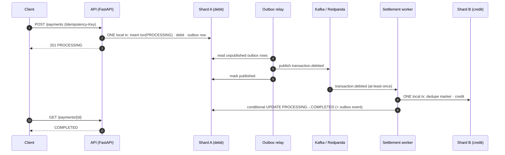

# HTTPE — High-Throughput Transaction Processing Engine

A sharded payment engine that moves money **correctly** under concurrency, retries and partial failure — and tells you honestly what it does and doesn't guarantee.

Built with Python, FastAPI, SQLAlchemy, Postgres (SQLite for zero-setup dev), and Kafka-compatible messaging (Redpanda). The interesting part is not the framework glue; it is the distributed-systems reasoning, written down in [`DECISIONS.md`](DECISIONS.md).

## What it guarantees

| Guarantee | How | Proven by |
|---|---|---|
| **No lost updates / no overdraft** under concurrent debits | One atomic conditional `UPDATE ... WHERE balance >= amount`; plus a DB `CHECK (balance_minor >= 0)` | `test_concurrency.py` (30 threads → exactly 10 succeed) |
| **A retried request never double-charges** | `UNIQUE(idempotency_key)` makes the claim atomic; a request fingerprint rejects key reuse with a different body | `test_idempotency.py` (12 racing threads, 1 execution) |
| **Same-shard transfers are fully ACID** | Debit + credit + status + outbox event in one local DB transaction | `test_settlement.py` |
| **Cross-shard transfers are never lost or duplicated** | Saga: local debit + outbox event commit atomically; worker credits idempotently; refund on failure | `test_settlement.py`, `test_invariants.py` |
| **Money is conserved** system-wide | Audit after concurrent mixed load: Σ balances unchanged, none negative, nothing stuck | `test_invariants.py`, `scripts/bench.py` |
| **A broker outage loses no events** | Transactional outbox + circuit breaker; rows wait in the table | `test_outbox_relay.py` |

**Honest caveat:** cross-shard payments are *eventually* consistent. For a short window the payer is debited and the payee not yet credited; the transaction reads `PROCESSING`. That is the unavoidable price of sharding (no cross-shard transaction coordinator) and is documented in [DECISIONS.md #5](DECISIONS.md).

## Architecture



* **Routing:** `shard = md5(account_id) mod N` — a pure function, no lookup service. A transaction lives on its **debit** account's shard; its id is `<shard>-<uuid>`, so `GET /payments/{id}` needs no global index.
* **Same-shard transfer:** everything in one ACID transaction; completes synchronously.
* **Cross-shard transfer:** saga + transactional outbox, as above. If the destination can't be credited (missing account / currency mismatch) the worker **refunds the payer and marks the transaction `FAILED`**, atomically.
* **Delivery:** at-least-once end to end; every consumer step is idempotent, so the net effect is exactly-once.

## Quick start (zero external services)

```bash
python -m venv .venv && source .venv/bin/activate
pip install -r requirements-dev.txt
pytest                                   # full suite
uvicorn app.main:app --reload            # 4 SQLite shards + in-memory bus + embedded worker
# open http://localhost:8000/docs
```

## Run the production-shaped stack

```bash
docker compose up --build
```

Brings up Postgres (4 shard databases), Redpanda (Kafka API), a one-shot schema-init job, the API (`EMBED_WORKER=false`) and a separate worker process. API docs at <http://localhost:8000/docs>.

> Deploying as a single service (Render, Railway, Fly…): the `Dockerfile` runs out of the box with default settings (SQLite + in-memory bus + embedded worker). That is a **demo** mode — data lives on the container's disk. For anything real, point `SHARD_URLS` at managed Postgres and set `EVENT_BUS_BACKEND=kafka`.

## API

| Method | Path | Notes |
|---|---|---|
| `POST` | `/accounts` | `{"owner_name","initial_balance":"100.00","currency":"INR"}` |
| `GET` | `/accounts/{id}` | balance as a decimal string |
| `POST` | `/payments` | **requires `Idempotency-Key` header**. `201` created · `200` + `Idempotent-Replay: true` on replay · `409` key reused with a different body · `422` insufficient funds / unknown account / currency mismatch / bad amount |
| `GET` | `/payments/{id}` | `PROCESSING` → `COMPLETED` or `FAILED` |
| `GET` | `/healthz` | liveness |

```bash
curl -X POST localhost:8000/accounts -H 'content-type: application/json' \
     -d '{"owner_name":"Alice","initial_balance":"500.00"}'

curl -X POST localhost:8000/payments -H 'content-type: application/json' \
     -H 'Idempotency-Key: order-1042' \
     -d '{"debit_account_id":"<alice>","credit_account_id":"<bob>","amount":"120.25"}'
# repeat the exact same call: the same transaction comes back, money moved once.
```

## Project layout

```
app/
  main.py                 app factory + lifespan (starts embedded worker if enabled)
  config.py               all settings, env-driven
  money.py                integer minor-unit conversions (no floats anywhere)
  api/routes.py           HTTP layer only - thin
  schemas/api.py          request/response validation
  db/models.py            schema + VALID_TRANSITIONS (state-machine source of truth)
  db/shard_router.py      hash routing + one engine/session factory per shard
  core/
    concurrency.py        atomic conditional UPDATE debit/credit/refund
    idempotency.py        claim-the-key-first, fingerprint check
    state_machine.py      conditional-UPDATE state transitions
    outbox.py             transactional outbox write/read helpers
    circuit_breaker.py    CLOSED/OPEN/HALF_OPEN, injectable clock
  events/                 bus abstraction (in-memory + Kafka), event payloads
  services/
    payments.py           create_payment: same-shard ACID path + saga step 1
    settlement.py         saga step 2: idempotent credit, finalise, refund-on-failure
    outbox_relay.py       outbox -> bus, behind the circuit breaker
    runtime.py            relay/consumer loops shared by API and worker
worker/run.py             standalone worker process
scripts/                  init_shards.py, bench.py (throughput + correctness audit)
loadtest/locustfile.py    HTTP load test incl. deliberate idempotent replays
tests/                    see below
docs/WALKTHROUGH.md       reading order + rebuild-it-yourself guide
```

## Configuration

| Variable | Default | Meaning |
|---|---|---|
| `SHARD_URLS` | 4× SQLite files in `./data` | comma-separated SQLAlchemy URLs; **position = shard index** |
| `EVENT_BUS_BACKEND` | `memory` | `memory` or `kafka` |
| `KAFKA_BOOTSTRAP_SERVERS` | `localhost:19092` | |
| `KAFKA_TOPIC_TRANSACTIONS` | `payments.transactions` | dead-letter topic is `<topic>.dlq` |
| `KAFKA_CONSUMER_GROUP` | `settlement-workers` | |
| `EMBED_WORKER` | `true` | run relay + settlement inside the API (memory bus only) |
| `OUTBOX_RELAY_INTERVAL_SECONDS` | `0.2` | relay poll interval (= settlement latency floor) |
| `BREAKER_FAILURE_THRESHOLD` / `BREAKER_RESET_TIMEOUT_SECONDS` | `5` / `30` | circuit breaker |

## Tests

```bash
pytest                 # 34 tests on SQLite shards, ~2 s (3 Postgres tests auto-skip)
pytest -m postgres     # real-Postgres concurrency + deadlock tests; needs TEST_POSTGRES_URLS
```

Covers: routing & money maths · state-machine legality incl. "only one caller wins a transition" · circuit breaker with a fake clock · idempotent replay, key reuse, and a 12-thread same-key race · 30-thread concurrent debit (rejects exactly the overdrafting ones) · saga happy path, redelivery, missing destination, currency mismatch (with refund) · outbox relay incl. broker outage and recovery · HTTP API incl. an end-to-end cross-shard payment through the embedded worker · a system-level **money-conservation** property under concurrent mixed load with duplicate keys.

The concurrency test was mutation-checked: swapping the atomic `UPDATE` for a naive read-modify-write makes it fail.

CI (`.github/workflows/ci.yml`) runs the suite on Python 3.11/3.12 **with a real Postgres service** (so the `postgres`-marked tests run), plus a benchmark smoke test with the correctness audit.

## Benchmark

```bash
python -m scripts.bench --seconds 10 --threads 16 --cross-shard-ratio 0.5
python -m scripts.bench --urls "postgresql+psycopg2://…/shard_0,…"   # against your own shards
```

It prints throughput and latency percentiles **and** audits the result (money conserved, nothing stuck) — a speed number from an incorrect run is worthless.

Reference run on a small shared cloud sandbox, default SQLite shards, in-process, 16 threads, 50% cross-shard:

| accepted payments/s | p50 | p95 | p99 | audit |
|---|---|---|---|---|
| ~600 | 8 ms | 106 ms | 338 ms | money conserved, 0 stuck |

This is bounded by SQLite's single-writer-per-file model and by Python; it is **not** a claim about production capacity. Throughput scales with the number of shards, with Postgres, and with more app processes — measure on your own hardware before quoting any number.

## Known limitations & what I'd build next

* **Fixed shard count.** `hash mod N` means changing N remaps most accounts. Next: consistent hashing or a directory service + online migration. (DECISIONS #1)
* **Eventual consistency across shards.** Readers can observe a `PROCESSING` transaction with the payer already debited. (DECISIONS #5)
* **Hot accounts.** All updates to one account serialise on its row; one very busy merchant account caps throughput. Mitigation: sub-accounts / sharded balance counters.
* **Idempotency keys are unique per debit-account shard**, not globally. A production API would scope keys per client/merchant. (DECISIONS #4)
* **Polling outbox relay** — simple, adds up to one poll interval of latency. Next: log-based CDC (e.g. Debezium).
* **Out of scope:** authentication, rate limiting, FX / non-2-decimal currencies, a refunds/reversals API, metrics/tracing, schema-migration tooling (Alembic).
* The automated tests use the in-memory bus; Kafka failure modes are tested by failing `publish` directly, not with a real broker outage. The Kafka adapter and `docker compose` stack have not been load-tested.

## License

MIT
