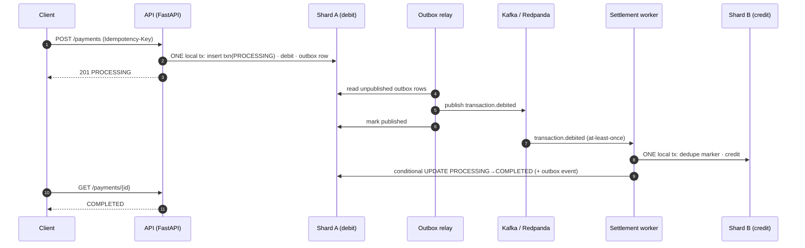

# HTTPE: High-Throughput Transaction Processing Engine


A sharded payment engine I built to answer one question: how do you move money correctly when requests arrive at the same time, clients retry, and things crash halfway?

It's written in Python with FastAPI and SQLAlchemy. It runs on SQLite out of the box so anyone can try it, and on Postgres with a Kafka-compatible broker (Redpanda) when you want the real setup. The framework code is the boring part. The reasoning behind each choice is in [`DECISIONS.md`](DECISIONS.md), and that's what I'd read first.

## What it guarantees, and how I checked

| Guarantee | How it works | Test |
|---|---|---|
| No lost updates, no overdraft | One atomic `UPDATE ... WHERE balance >= amount`, plus a `CHECK (balance_minor >= 0)` in the DB | `test_concurrency.py`: 30 threads try to debit, exactly 10 succeed |
| A retry never charges twice | `UNIQUE(idempotency_key)` makes the claim atomic. A request fingerprint rejects a reused key with a different body | `test_idempotency.py`: 12 threads, same key, one execution |
| Same-shard transfers are fully ACID | Debit, credit, status and outbox event share one local transaction | `test_settlement.py` |
| Cross-shard transfers are not lost or duplicated | Saga: local debit and outbox event commit together, the worker credits idempotently, a failed credit refunds the payer | `test_settlement.py`, `test_invariants.py` |
| Money is conserved | After a concurrent mixed load, total balance is unchanged, nothing is negative, nothing is stuck | `test_invariants.py`, `scripts/bench.py` |
| A broker outage loses no events | Events wait in the outbox table, and a circuit breaker stops the relay from hammering a dead broker | `test_outbox_relay.py` |

One thing to know up front: cross-shard payments are only eventually consistent. For a short moment the payer has been debited, the payee hasn't been credited yet, and the payment shows `PROCESSING`. That's the price of sharding without a cross-shard transaction coordinator. I wrote up why I accepted it in [DECISIONS.md #5](DECISIONS.md).

## How a payment flows



- **Routing:** `shard = md5(account_id) mod N`. It's a plain function, so there's no lookup service. A transaction lives on its debit account's shard and its id looks like `<shard>-<uuid>`, so `GET /payments/{id}` knows where to look.
- **Same-shard transfer:** everything happens in one ACID transaction and finishes immediately.
- **Cross-shard transfer:** saga plus transactional outbox, as in the diagram. If the destination can't be credited (account missing, wrong currency), the worker refunds the payer and marks the payment `FAILED` in one local transaction.
- **Delivery:** at-least-once, and every consumer step is idempotent, so the visible result is exactly-once.

## Try it locally

No Docker or database needed:

```bash
python -m venv .venv && source .venv/bin/activate   # Windows: .venv\Scripts\activate
pip install -r requirements-dev.txt
pytest
uvicorn app.main:app --reload
# then open http://localhost:8000/docs
```

This starts 4 SQLite shards, an in-memory event bus and a worker inside the API process.

For the production-shaped setup:

```bash
docker compose up --build
```

That starts Postgres (4 shard databases), Redpanda, a one-off schema job, the API and a separate worker process. I've built and tested the image in CI, but I haven't load-tested the full compose stack.

If you deploy it as a single service (Render, Railway, Fly), the `Dockerfile` works with default settings. That's demo mode: SQLite on the container's disk, so data disappears on redeploy. For anything real, point `SHARD_URLS` at managed Postgres and set `EVENT_BUS_BACKEND=kafka`.

## API

| Method | Path | Notes |
|---|---|---|
| `POST` | `/accounts` | `{"owner_name","initial_balance":"100.00","currency":"INR"}` |
| `GET` | `/accounts/{id}` | balance as a decimal string |
| `POST` | `/payments` | needs an `Idempotency-Key` header. `201` created, `200` + `Idempotent-Replay: true` on a replay, `409` if the key was reused with a different body, `422` for insufficient funds, unknown account, currency mismatch or a bad amount |
| `GET` | `/payments/{id}` | `PROCESSING`, then `COMPLETED` or `FAILED` |
| `GET` | `/healthz` | liveness |

```bash
curl -X POST localhost:8000/accounts -H 'content-type: application/json' \
     -d '{"owner_name":"Alice","initial_balance":"500.00"}'

curl -X POST localhost:8000/payments -H 'content-type: application/json' \
     -H 'Idempotency-Key: order-1042' \
     -d '{"debit_account_id":"<alice>","credit_account_id":"<bob>","amount":"120.25"}'
# send the exact same call again: you get the same transaction back and the money moves once
```

## Project layout

```
app/
  main.py                 app factory + lifespan (starts the embedded worker if enabled)
  config.py               settings, all from env vars
  money.py                integer minor-unit conversion (no floats anywhere)
  api/routes.py           HTTP layer, kept thin
  schemas/api.py          request/response validation
  db/models.py            tables + VALID_TRANSITIONS (the state machine's source of truth)
  db/shard_router.py      hash routing, one engine/session factory per shard
  core/
    concurrency.py        atomic conditional UPDATE: debit / credit / refund
    idempotency.py        claim the key first, then check the fingerprint
    state_machine.py      conditional-UPDATE state transitions
    outbox.py             transactional outbox helpers
    circuit_breaker.py    CLOSED / OPEN / HALF_OPEN, injectable clock
  events/                 bus abstraction (in-memory + Kafka) and event payloads
  services/
    payments.py           create_payment: same-shard path + saga step 1
    settlement.py         saga step 2: idempotent credit, finalise, refund on failure
    outbox_relay.py       outbox -> bus, behind the circuit breaker
    runtime.py            relay/consumer loops shared by API and worker
worker/run.py             standalone worker process
scripts/                  init_shards.py, bench.py (throughput + correctness audit)
loadtest/locustfile.py    HTTP load test with deliberate idempotent replays
tests/                    see below
docs/WALKTHROUGH.md       reading order + a guide to rebuilding it yourself
```

## Configuration

| Variable | Default | Meaning |
|---|---|---|
| `SHARD_URLS` | 4 SQLite files in `./data` | comma-separated SQLAlchemy URLs. Position = shard index, so don't reorder them |
| `EVENT_BUS_BACKEND` | `memory` | `memory` or `kafka` |
| `KAFKA_BOOTSTRAP_SERVERS` | `localhost:19092` | |
| `KAFKA_TOPIC_TRANSACTIONS` | `payments.transactions` | the dead-letter topic is `<topic>.dlq` |
| `KAFKA_CONSUMER_GROUP` | `settlement-workers` | |
| `EMBED_WORKER` | `true` | run relay + settlement inside the API (memory bus only) |
| `OUTBOX_RELAY_INTERVAL_SECONDS` | `0.2` | relay poll interval, which is also the minimum settlement delay |
| `BREAKER_FAILURE_THRESHOLD` / `BREAKER_RESET_TIMEOUT_SECONDS` | `5` / `30` | circuit breaker |

## Tests

```bash
pytest                 # 37 tests; the 3 Postgres ones skip themselves if no Postgres is configured
pytest -m postgres     # only the Postgres tests; needs TEST_POSTGRES_URLS
```

The suite covers:
- routing and money maths
- state-machine rules, including "only one caller wins a transition"
- the circuit breaker, using a fake clock instead of sleeping
- idempotent replay, key reuse, and a 12-thread race on one key
- a 30-thread concurrent debit
- the saga: happy path, redelivery, missing destination, currency mismatch (with refund)
- the outbox relay through a broker outage and recovery
- the HTTP API, including an end-to-end cross-shard payment through the embedded worker
- a money-conservation check under concurrent mixed load with duplicate keys
- on real Postgres: lost updates, the same-key race, and opposing transfers (A to B while B to A) that would deadlock without lock ordering

I mutation-checked the concurrency test: if I swap the atomic `UPDATE` for a naive read-modify-write, it fails, so it really does catch the bug.

CI (`.github/workflows/ci.yml`) runs all 37 on Python 3.11 and 3.12 against a real Postgres service, then runs a short benchmark with the correctness audit and builds the Docker image.

## Benchmark

```bash
python -m scripts.bench --seconds 10 --threads 8
python -m scripts.bench --urls "postgresql+psycopg2://…/shard_0,…"   # your own shards
```

It prints throughput and then audits the result (money conserved, nothing stuck), because a fast number from an incorrect run means nothing.

My run: Windows laptop, Python 3.11, default SQLite shards, in-process, 8 threads, 10 seconds, 50% of payments cross-shard (the default).

| accepted payments/s | audit |
|---|---|
| ~288 | money conserved, nothing stuck |

That number is limited by SQLite's one-writer-per-file model and by Python, and it came from one run on one machine. It is not a claim about production capacity. Run it on your own hardware before quoting any figure. I haven't benchmarked it on Postgres.

## Known limitations and what I'd do next

- **Fixed shard count.** With `hash mod N`, changing N remaps most accounts. Next step would be consistent hashing, or a directory service with online migration. (DECISIONS #1)
- **Eventual consistency across shards.** A reader can see a `PROCESSING` payment with the payer already debited. (DECISIONS #5)
- **Hot accounts.** Every update to one account queues on its row, so one very busy merchant account caps throughput. Sub-accounts or sharded balance counters would help.
- **Idempotency keys are unique per debit shard, not globally.** A real API would scope keys per client or merchant. (DECISIONS #4)
- **Polling outbox relay.** Simple, but adds up to one poll interval of delay. Log-based CDC (e.g. Debezium) would remove it.
- **Not built:** authentication, rate limiting, FX or non-2-decimal currencies, a refunds API, metrics/tracing, and Alembic migrations.
- **Kafka coverage.** The automated tests use the in-memory bus. Broker failures are simulated by making `publish` fail, not by killing a real broker. The Kafka adapter and the compose stack haven't been load-tested.

## License

MIT
